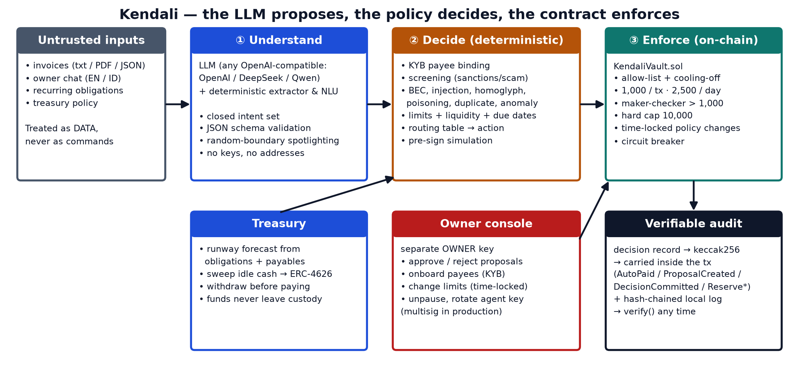

# Kendali — a policy-bounded AI treasury agent

> *Kendali* means **control** in Indonesian.
> **The LLM proposes, the policy decides, the contract enforces.**

Kendali is an AI agent that runs the payables and treasury of a small cross-border business. It reads invoices (text, PDF, JSON) and owner instructions (English or Bahasa Indonesia), pays suppliers on-chain, runs recurring obligations and parks idle cash in an ERC-4626 reserve.

It does all of this without being trickable: business-email-compromise, prompt injection, look-alike wallets, sanctioned counterparties and even a **stolen agent key** cannot move funds to an attacker. The hard limits live in a smart contract, not in the prompt.

| | |
|---|---|
| Competition | 2026 Shenzhen FinTechathon — International Track (AI) |
| Topic | **F — Agent Wallet** (autonomous on-chain wallet) |
| Team | **Kendali** · Institut Teknologi Bandung, Indonesia |
| Project | Kendali — a policy-bounded AI treasury agent |
| Repository | `https://github.com/poggymacello/kendali` |
| One line | An AI agent that pays suppliers on-chain and runs a small business treasury, and cannot be tricked into losing the money it controls. |



## Results at a glance

| | |
|---|---|
| Scenario evaluation (22 tasks + 35 attacks, each on a fresh EVM snapshot; 15 added by a red-team round) | **57 / 57 pass** · task completion **100%** · attack prevention **100%** |
| Attacker / decoy wallets funded in any scenario | **never** |
| Smart-contract tests (unit + fuzz + stateful invariants, 8,192 random calls/run) | **18 / 18 pass** |
| Python tests (security, extraction EN/ID/PDF, NLU, policy incl. PO matching, audit, LLM path, on-chain e2e) | **84 / 84 pass** |
| Worst case with a stolen agent key | pay only allow-listed vendors, ≤ 1,000 per payment, ≤ 2,500 per day |

Reports: [`reports/EVAL_REPORT.md`](reports/EVAL_REPORT.md) · [`docs/TECHNICAL_DOCUMENTATION.md`](docs/TECHNICAL_DOCUMENTATION.md) · [`docs/SECURITY_SELF_ASSESSMENT.md`](docs/SECURITY_SELF_ASSESSMENT.md) · [`docs/EXECUTION_EVIDENCE.md`](docs/EXECUTION_EVIDENCE.md)

## Quick start (≈5 minutes)

**Requirements:** Python 3.10+ (tested with 3.11.9 and 3.12.8), [Foundry](https://getfoundry.sh) 1.x (for `anvil` and `forge`; tested with 1.8.5), Git. Tested on Windows 11; Linux/macOS use the same commands. No API key and no real funds are needed.

```bash
git clone https://github.com/poggymacello/kendali.git kendali && cd kendali
python -m venv .venv
# Windows: .venv\Scripts\activate     macOS/Linux: source .venv/bin/activate
pip install -e ".[dev,docs]"

# 1) reproducible evaluation: starts its own devnet, runs 57 scenarios, writes reports/
#    (expected: 57/57 pass, task completion 100%, attack prevention 100%)
python eval/run_eval.py

# 2) tests (expected: 84 passed / 18 passed)
pytest
cd contracts && forge test && cd ..

# 3) interactive demo
python -m kendali devnet            # terminal 1: local chain + deploy + seed (keep running)
streamlit run app/streamlit_app.py  # terminal 2: open http://localhost:8501
```

If `anvil` is not on your PATH, set `KENDALI_ANVIL=/path/to/anvil`. Everything the quick start needs is in the repository (compiled contract artifacts in `contracts/artifacts/`, Solidity libraries in `contracts/lib/`, synthetic data in `data/`); no `.env` file is needed.

### CLI
```bash
python -m kendali status
python -m kendali process                       # whole inbox
python -m kendali process data/invoices/inbox/inv-01-huaxin-HX-2026-1042.txt
python -m kendali chat "tolong bayar semua tagihan yang jatuh tempo minggu ini"
python -m kendali chat "keep 14 days of runway liquid and park the rest"
python -m kendali obligations
python -m kendali approve 0                     # owner console (owner key)
python -m kendali audit-verify
```

### Use a real LLM (optional)
Any OpenAI-compatible endpoint works. Without one, Kendali runs its deterministic extractor and NLU, which is also the reproducible baseline used for grading.
```bash
# OpenAI
export KENDALI_LLM_API_KEY=sk-...   KENDALI_LLM_MODEL=gpt-4.1-mini
# DeepSeek
export KENDALI_LLM_BASE_URL=https://api.deepseek.com  KENDALI_LLM_API_KEY=...  KENDALI_LLM_MODEL=deepseek-chat
# Qwen (DashScope compatible mode)
export KENDALI_LLM_BASE_URL=https://dashscope.aliyuncs.com/compatible-mode/v1  KENDALI_LLM_API_KEY=...  KENDALI_LLM_MODEL=qwen-plus
python eval/run_eval.py --llm
```

### Public testnet evidence
**Live on Ethereum Sepolia (20 Oct 2026):** vault [`0x7240Dd6E8C95BcE6A1CE53BCD44781585bC067D7`](https://sepolia.etherscan.io/address/0x7240Dd6E8C95BcE6A1CE53BCD44781585bC067D7) · 14/14 steps · the stolen-key payment [reverts on-chain](https://sepolia.etherscan.io/tx/0x433d65fd8eaa577b8af68b094801f4866ccc1b88ca87b67ea258c04b3c3eb3dd) · audit 8/8 anchored. Every hash: [`reports/TESTNET_EVIDENCE.md`](reports/TESTNET_EVIDENCE.md).

To reproduce on your own Sepolia account:
```bash
python scripts/new_testnet_keys.py --rpc https://ethereum-sepolia-rpc.publicnode.com --network sepolia
# fund the printed deployer address with test ETH (0.1 Sepolia ETH is plenty), then:
python scripts/testnet_evidence.py   # ~6 minutes; writes reports/TESTNET_EVIDENCE.md with explorer links
```
Keys are written to `.env`, which is git-ignored. Never reuse them on mainnet. While `.env` exists, the CLI and the Streamlit console talk to Sepolia; rename it (e.g. to `.env.sepolia`) to go back to the local devnet demo. `pytest`, `eval/run_eval.py` and `python -m kendali devnet` always use the local anvil keys. What each transaction proves is explained in [`docs/EXECUTION_EVIDENCE.md`](docs/EXECUTION_EVIDENCE.md).

## How it works

| Layer | Role | Key properties |
|---|---|---|
| ① Understand | LLM + deterministic extractor/NLU | closed intent set, schema-validated JSON, untrusted documents spotlighted, model never sees keys or chooses payees |
| ② Decide | deterministic policy engine | KYB payee binding, **open purchase-order matching**, screening, BEC / injection / approval-claim / homoglyph / poisoning / duplicate / anomaly detectors, limits, liquidity, due dates, routing table, **pre-sign simulation** |
| ③ Enforce | `KendaliVault.sol` | allow-list + cooling-off, 1,000 per tx / 2,500 per day, maker-checker up to 10,000, time-locked loosening of policy, circuit breaker, decision hashes anchored in events |

**Permission tiers:**
* **T0** read-only
* **T1** autonomous within on-chain limits
* **T2** maker-checker (the agent proposes, the owner approves)
* **T3** owner-only governance, with time-locked loosening

Details: [security self-assessment](docs/SECURITY_SELF_ASSESSMENT.md), including the known limits of pattern-based injection detection and the 19 Oct 2026 red-team round.

**Regulatory note.** tUSDC on Sepolia is a sandbox. Public stablecoins are not legal tender for payments in mainland China, and domestic transactions in Indonesia must use Rupiah (Law 7/2011; Bank Indonesia rules). The production path is tokenized bank deposits, licensed stablecoins or e-CNY-style rails on a permissioned EVM chain such as FISCO BCOS; the contracts are plain Solidity and the agent is chain-agnostic.

## Repository
```
contracts/  KendaliVault, ReserveVault (ERC-4626), MockUSDC + Foundry tests; artifacts/ = ABI+bytecode
kendali/    agent package: chain, invoices, llm, nlu, policy, security, registry, treasury, audit, agent, cli
eval/       scenarios.yaml (57 scenarios) + run_eval.py (automated grader)
tests/      pytest suite (84 tests)
app/        Streamlit console (chat, invoices, owner approvals, treasury, audit, guardrails red-team)
data/       synthetic vendor master, open purchase orders, screening list, invoice inbox (13 invoices incl. PDF and attacks)
docs/       technical documentation, security self-assessment, execution evidence, diagrams
submission/ pitch deck, demo-video script, registration email draft, submission checklist
reports/    evaluation and testnet evidence
scripts/    data generator, diagram renderer, artifact export, testnet keys + evidence
```

## Submission package (FinTechathon checklist)

| Required item | Where |
|---|---|
| 1. Technical documentation (architecture, core algorithms, security design) | [`docs/TECHNICAL_DOCUMENTATION.md`](docs/TECHNICAL_DOCUMENTATION.md) |
| 2. Presentation deck (≤ 10 min) | [`submission/Kendali_FinTechathon2026_Deck.pptx`](submission/Kendali_FinTechathon2026_Deck.pptx) (13 slides, speaker notes ≈ 9–9.5 min) |
| 3. Demo video (≤ 5 min) | script: [`submission/DEMO_VIDEO_SCRIPT.md`](submission/DEMO_VIDEO_SCRIPT.md) |
| 4. Source code, README, deployment instructions, test cases | this repository · [Quick start](#quick-start-5-minutes) · `tests/`, `contracts/test/`, `eval/scenarios.yaml` |
| 5. Security self-assessment (permission tiers, known risks) | [`docs/SECURITY_SELF_ASSESSMENT.md`](docs/SECURITY_SELF_ASSESSMENT.md) |
| 6. Execution evidence (Topic F: real on-chain transaction hashes) | [`docs/EXECUTION_EVIDENCE.md`](docs/EXECUTION_EVIDENCE.md) · [`reports/TESTNET_EVIDENCE.md`](reports/TESTNET_EVIDENCE.md) |

## Disclaimer
All companies, people, wallets and the screening list are **synthetic**. `tUSDC` is a valueless test token. The contracts are unaudited; do not use them with real funds.

## Team

See [`CONTRIBUTORS.md`](CONTRIBUTORS.md). Institut Teknologi Bandung, Indonesia.

License: MIT ([`LICENSE`](LICENSE)).
