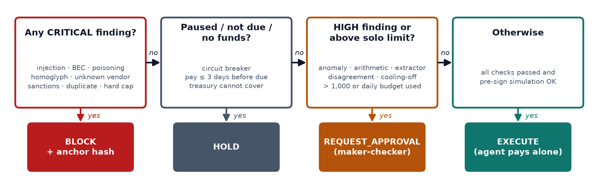

# Kendali — Technical Documentation

**Team:** [TEAM NAME] · Institut Teknologi Bandung (Indonesia)
**Track:** FinTechathon 2026 International Track · **Topic F — Agent Wallet (autonomous on-chain wallet)**
**One line:** Kendali is an AI treasury agent for small businesses. It reads invoices and instructions, pays suppliers on-chain and runs the treasury on its own, and it cannot be tricked into losing the money it controls.

---

## 1. Problem

Small businesses that trade across borders (our persona: *Kopi Nusantara Roastery*, a Bandung coffee exporter paying suppliers in Indonesia, Shenzhen and Singapore) have no finance team. Delegating payments to an AI agent is attractive, but it creates a new attack surface:

* **Invoice and payment fraud is the dominant loss vector.** Business email compromise ("our wallet changed, pay urgently"), look-alike wallets and fake vendors cost businesses billions every year. In Indonesia, OJK's Indonesia Anti-Scam Centre logged 702,342 scam reports between November 2024 and September 2026.
* **An AI agent that reads documents can be instructed by those documents.** This is prompt injection. If the model also holds a key, a single malicious PDF becomes a theft.
* **Agent hosts get compromised.** If the agent's key is stolen, nothing should depend on the attacker behaving politely.

**Design goal:** an *AI financial participant* that does real work autonomously (task completion) while staying safe even when its inputs, its model and its server are hostile (security and compliance).

## 2. Solution overview


Kendali separates **understanding**, **deciding** and **enforcing** into three independent layers:

1. **Understand (LLM + deterministic NLU/extractor).** Turns invoices (text, PDF, JSON) and owner chat (English or Bahasa Indonesia) into structured fields and intents from a *closed* set. Any OpenAI-compatible model works (OpenAI, DeepSeek, Qwen/DashScope, local vLLM). The deterministic path is the reproducible baseline and the mandate filter.
2. **Decide (deterministic policy engine).** Applies KYB payee binding, screening, fraud detectors, on-chain limits, liquidity and due dates. Routes each item to EXECUTE / REQUEST_APPROVAL / HOLD / BLOCK with reason codes and a bilingual explanation, then **simulates the exact transaction before signing**.
3. **Enforce (`KendaliVault` smart contract).** The agent's key can only do what the contract allows: pay allow-listed, cooled-off payees within per-payment and daily limits, propose larger payments for the owner's approval, move cash between the vault and its ERC-4626 reserve, pause, and anchor decision hashes.

Every decision is hashed (keccak256) **before** signing, and the hash is carried inside the transaction. That makes the AI's reasoning tamper-evident and verifiable on-chain.

## 3. Capabilities (tasks the agent completes)

| Task | How | Evidence |
|---|---|---|
| Pay supplier invoices end-to-end | ingest → extract → verify → route → simulate → `pay()` | T01, T06, T07, T12 |
| Maker-checker for large or unusual payments | `propose()` → owner `approveProposal()` | T02, T04, T09 |
| Recurring obligations (rent, SaaS, freight) | monthly references; idempotent per period | T08–T10 |
| Treasury runway management | forecast obligations + payables + pending proposals → keep a runway, sweep the rest into ERC-4626, withdraw before paying | T11, T12 |
| Daily budget management | reroute to approval instead of failing when the solo budget is used | T13 |
| Natural-language operation (EN/ID) | "pay all invoices due this week", "tolong bayar semua tagihan…", cash report, audit questions | T14–T17 |
| Emergency stop | agent or owner can pause; only owner resumes | T18 |
| Verifiable audit | `audit-verify` recomputes hashes and checks on-chain anchors | T19, A22 |

## 4. Core algorithms

### 4.1 Invoice understanding with cross-checking
* **Deterministic extractor** (`invoices.py`): bilingual field patterns (From/Dari, Invoice No/Nomor Faktur, Due Date/Jatuh Tempo, Total/Jumlah Tagihan…), line-item parsing, and an arithmetic check (qty × price = amount; Σ items = total). PDF text comes from `pypdf`.
* **LLM extractor** (optional): the same fields as JSON, with the document wrapped in a random boundary and declared as untrusted data. The model also reports `embedded_instructions`.
* **Cross-check:** if the two extractors disagree on total, invoice number or due date, the result is `EXTRACTION_MISMATCH` and goes to a human. If the LLM reports embedded instructions, the result is `PROMPT_INJECTION` and the invoice is blocked. **The LLM never chooses the payee.**

### 4.2 Payee binding
The payee is always the wallet stored in the KYB-verified vendor master (`data/vendors.json`). The `keccak` hash of each KYB record is anchored on-chain when the owner adds the payee. Any wallet written on an invoice is treated as a claim to verify:

| Invoice wallet | Result |
|---|---|
| same as KYB | OK |
| shares the KYB wallet's visible prefix/suffix | `ADDRESS_POISONING` → BLOCK |
| different | `PAYMENT_DETAILS_CHANGED` → BLOCK, plus a call-back instruction using the contact on file |

### 4.3 Fraud and manipulation detectors (`security.py`)
* **Prompt injection.** English and Indonesian patterns, run after removing zero-width and bidi-override characters.
* **Hidden characters and encoded payloads.**
* **Social-engineering pressure.** Urgency, penalties, "new bank details".
* **Homoglyph impersonation.** Cyrillic/Greek look-alikes are folded, and the attempt is flagged rather than forgiven.
* **Registration-number mismatch, unknown issuer, currency mismatch.**
* **Duplicate references.** Checked in the local ledger and on-chain (`usedRef`).
* **Amount anomaly.** Above 1.25× the vendor's usual maximum.

### 4.4 Routing table (`policy.py`)



Severity weights: info 0, low 5, medium 15, high 30, critical 100. A risk score of 15 or more also triggers approval. The table is small enough to unit-test exhaustively (`tests/test_policy.py`).

### 4.5 Pre-sign simulation and safe rerouting
Before signing, the agent runs `eth_call` on the exact call it is about to send. A revert is decoded into the contract's custom error (e.g. `ExceedsDailyLimit(2850000000, 2500000000)`) and handled as follows:
* `ExceedsAutoLimit`, `ExceedsDailyLimit` or `PayeeCoolingDown` → the payment is rerouted to a proposal.
* Any other revert → BLOCK.

This covers the race where on-chain state changes between the decision and signing.

### 4.6 Treasury runway algorithm (`treasury.py`)
```
needs  = Σ obligations due within N days (excluding ones already paid this period)
       + Σ held invoices due within N days + Σ pending proposals
target = max(2,000, 1.2 × needs)
if liquid − target ≥ 250  → sweepToReserve(liquid − target)
if liquid < target         → withdrawFromReserve(min(target − liquid, reserve))
```
Before an individual payment that exceeds liquid cash, the agent first withdraws the shortfall from the reserve (`RESERVE_WITHDRAWAL`). Reserve shares are held by the vault itself, so funds never leave custody.

### 4.7 Verifiable audit (`audit.py`)
* `decision_hash = keccak256(canonical_json(decision))`, computed before signing and passed as the `decisionHash` argument of `pay`, `propose`, `sweepToReserve`, `withdrawFromReserve` or `commitDecision`.
* Local log entries are hash-chained: `entry_hash = sha256(prev_hash ‖ canonical(entry))`.
* `verify()` recomputes every decision hash and the chain, then checks that every value-moving or blocking decision is present in on-chain events. Editing or deleting a record is detected (A22).

## 5. Smart contracts

| Contract | Purpose | Size |
|---|---|---|
| `KendaliVault.sol` | policy-bounded treasury: roles, limits, allow-list, cooling-off, maker-checker, timelock, circuit breaker, decision anchoring | ≈400 lines |
| `ReserveVault.sol` | ERC-4626 reserve (OpenZeppelin), virtual-share offset 6 against inflation attacks | 20 lines |
| `MockUSDC.sol` | 6-decimal test stablecoin (valueless) | 20 lines |

**Key invariants** (proved by stateful fuzzing, `KendaliVaultInvariantTest`, 8,192 random calls per run):
1. A non-allow-listed address never receives funds from the agent key.
2. Agent-alone outflow ≤ `dailyAutoLimit` per elapsed day.
3. The agent can never change limits, payees, owner or agent.
4. Treasury value is conserved except for legitimate payments (custody never leaks to the reserve or the agent).

**Gas** (Foundry gas report, Cancun EVM):

| Function | Typical | Max |
|---|---|---|
| `pay` | 36,922 (median) | 117,255 (first payment to a fresh payee and day bucket) |
| `propose` | 145,648 (median) | 165,938 |
| `approveProposal` | 39,976 (median) | 83,062 |
| `commitDecision` (audit anchor) | 25,754 | 25,754 |
| `sweepToReserve` / `withdrawFromReserve` | 144,540 / 70,129 | |

## 6. Interaction design
* **Chat (EN/ID).** The owner speaks naturally. The agent answers with decision cards: action badge, reason codes, a bilingual explanation, a risk score and links to the transactions.
* **Owner console.** Approve or reject proposals, unpause, onboard payees. It is signed with a separate owner key; in production this runs on the owner's device or a multisig.
* **Treasury view.** Runway slider, obligations calendar, liquid vs reserve.
* **Audit view.** One-click verification against the chain.
* **Guardrails view.** A live red-team button simulates stolen-key attacks and shows the contract's rejections.
* **CLI** for automation, plus a JSON evaluation harness for automated grading.

## 7. Evaluation

| Suite | Result |
|---|---|
| Foundry: 17 unit/fuzz tests + 4 invariants | **18/18 pass** |
| pytest: security, extraction (EN/ID/PDF), NLU, policy, audit, LLM path (local OpenAI-compatible server), on-chain e2e | **55/55 pass** |
| Scenario harness: 19 tasks + 23 attacks on a fresh EVM snapshot each | **42/42 pass** · task completion **100%** · attack prevention **100%** · attacker wallets never funded · 91 transactions |
| Public-testnet evidence run | `reports/TESTNET_EVIDENCE.md` |

The scenario harness is deterministic and needs no API key. `python eval/run_eval.py --llm` repeats it with any configured model.

## 8. Deployment
* **Local:** `python -m kendali devnet` (anvil + deploy + seed), `streamlit run app/streamlit_app.py`.
* **Public testnet:** `python scripts/new_testnet_keys.py --rpc <RPC>`, fund the printed address, then `python scripts/testnet_evidence.py`.
* **Chain-agnostic:** standard Solidity 0.8.24 (Cancun) and any ERC-20 settlement asset. Production candidates are permissioned EVM-compatible chains such as FISCO BCOS, and settlement in tokenized deposits, licensed stablecoins or CBDC pilots. Portability to FISCO BCOS has not been tested yet; see the security report, R6.

## 9. Roadmap
1. Owner as multisig, plus an ERC-4337 smart account with session keys, so the agent key becomes a scoped session key.
2. Per-payee caps and on-chain anomaly auto-pause.
3. Real screening feeds (OFAC/UN/local regulator lists and a sanctions oracle) and FATF travel-rule data exchange.
4. OCR for scanned invoices; e-invoice (e-Faktur / UBL) ingestion.
5. Pilot with SME cross-border sellers, connected to bank tokenized-deposit rails.

## 10. Repository map
```
contracts/   Solidity (src, test, artifacts)      kendali/   Python agent package
eval/        scenarios.yaml + run_eval.py           tests/     pytest suite
app/         Streamlit console                      scripts/   data, diagrams, testnet evidence
data/        vendor master, screening list, inbox   docs/      this document, security report
reports/     evaluation + testnet evidence
```
